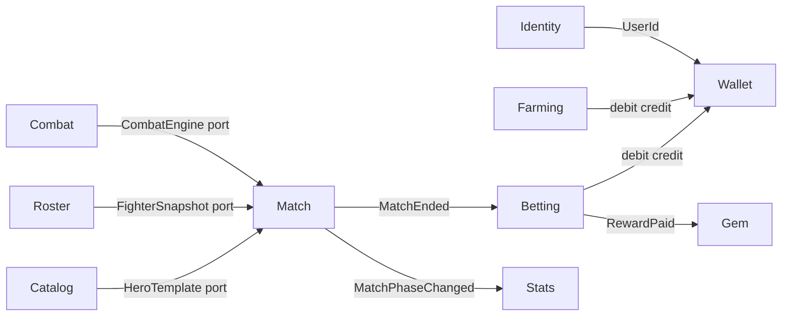

# Refactor source theo hexagonal DDD

Giữ NestJS làm composition root. Mỗi bounded context có 4 lớp. `domain` và `application` là TypeScript thuần. Nest, TypeORM, Bull, Redis, cron, socket chỉ xuất hiện ở `infrastructure` và `presentation`.

## Hiện trạng cần tách

Toàn bộ provider nằm trong [`src/app.module.ts`](src/app.module.ts). Entity TypeORM nằm ở [`src/migrations/entities`](src/migrations/entities) và gắn luôn GraphQL (`@Field`, `@ObjectType`).

Ba điểm coupling quyết định thứ tự migrate:

- Combat bị nhân đôi và stateful. [`RoundService`](src/app/round/round.service.ts) giữ `this.home` / `this.away` trên singleton rồi loop tối đa 20 turn. [`EloMatchService`](src/app/elo-match/elo-match.service.ts) và [`TurnService`](src/app/turn/turn.service.ts) lặp lại vòng đánh. Skill là `switch (home.name)` trong [`SkillFactory`](src/app/skill/skill.factory.ts).
- Ví là cột `users.balance`. [`BetService`](src/app/bet/bet.service.ts), [`RewardService`](src/app/reward/reward.service.ts) và [`TreeService`](src/app/tree/tree.service.ts) `update` thẳng `UserRepository`, kể cả SQL nội suy `` `balance - ${body.balance}` ``.
- Vòng đời trận và trả thưởng dính nhau. [`PreMatchCron`](src/app/match/pre-match.cron.ts) mở cửa bet rồi hẹn Bull +1 phút / +3 phút. [`BetConsumer`](src/app/bet/bet.consumer.ts) gọi `FightingService` (đổi status + socket) và `RewardService` (đóng trận, cộng `balance * 2`, roll gem).

`RoundService.execute()` mô phỏng xong, lưu `turns`/`winner`, rồi xóa winner/turns trên object trả về để client chưa thấy kết quả. Hành vi này phải được giữ bằng một read model, không được “sửa” khi tách lớp.

## Context map



Giao tiếp đồng bộ qua port do context gọi sở hữu (application interface). Giao tiếp bất đồng bộ qua domain event. Context không import repository, entity TypeORM, hay service Nest của context khác.

Realtime (Socket.IO, Bull `socket.io`) là adapter: subscribe event rồi emit. Nó không phải domain.

## Luật phụ thuộc

```
src/
  shared/kernel/                 # Money, EntityId, DomainEvent, DomainError, Clock
  contexts/<name>/
    domain/                      # aggregate, VO, domain service, event
    application/                 # use case + port (interface)
    infrastructure/              # TypeORM mapper, repo adapter, cron, queue, Nest module
    presentation/                # controller, resolver, DTO
  platform/                      # redis, mail, graphql driver, socket emitter
```

- `domain/**` và `application/**` cấm import `@nestjs/*`, `typeorm`, `bull`, `cache-manager`, `bcrypt`.
- `presentation` chỉ gọi use case. DTO và class-validator ở đây.
- Persistence mapper nằm trong infrastructure. Bảng MySQL giữ nguyên; không đổi schema trong đợt này.
- Chặn vi phạm bằng `eslint-plugin-boundaries` (hoặc `dependency-cruiser`) trên các folder trên.
- Shared kernel chỉ có kiểu thật sự dùng chung: `Money` (số nguyên, vì cột `decimal(50,0)`), `EntityId`, `DomainEvent`, `Clock`. Không có generic repository TypeORM.

Nest module của mỗi context chỉ làm composition: bind port sang adapter và khai báo controller.

## Aggregate và invariant

- **Combat** (domain service, không persist): `Fighter`, `Turn`, `Skill` strategy (Hell, Sphinx, …). `CombatEngine.fight(home, away)` thuần hàm, trả `CombatResult` (winner, turns, tối đa 20 turn). RNG đi qua port `RandomSource` để test được. Một instance mỗi trận, không field trên singleton.
- **Match**: phase `Scheduled | Betting | Fighting | Ended`. Mở betting thì chạy engine, lưu full replay ở trong, public view che `winner`/`turns` cho đến `Ended`. `MatchOpened`, `MatchFighting`, `MatchEnded`.
- **Bet**: một user một vé mỗi match, chỉ khi match đang `Betting`, stake `> 0` và `<=` số dư. `BetPlaced`.
- **Wallet**: `debit` / `credit`, số dư không âm. Adapter ghi `users.balance` bằng query tham số. `available_balance` thuộc wallet, không thuộc identity.
- **User** (Identity): email, password hash, role, confirmed, address. Hash qua port `PasswordHasher`. Entity domain không có `@BeforeInsert`.
- **Hero** (Catalog): template chỉ đọc. **UserHero** (Roster): cộng điểm, elo. Elo cập nhật khi có `EloMatchEnded`, không nằm trong engine combat.
- **Gem**: level-up và drop. Drop là subscriber của `RewardPaid`, không nằm trong settlement.
- **Plot** (Farming): trồng trừ 1% ví, cướp cây. Làm tròn tiền nằm trong domain (`Money`), không nhân `number` ở service.

`BetStatusConstant` đang kiêm phase của match. Trong domain match đổi thành `MatchPhase`. Constant cũ chỉ còn ở mapper cho đến khi xóa code cũ.

Các file [`tower-match.entity.ts`](src/migrations/entities/tower-match.entity.ts) và [`guild-match.entity.ts`](src/migrations/entities/guild-match.entity.ts) đang `export class EloMatchEntity`. Khi vào context Match, gom về một aggregate `Match` với `MatchType` (`public`, `elo`, `rob`, `tower`, `guild`) map cột `type`.

## Use case mẫu cho lát cắt Betting

`PlaceBet`:

1. `MatchQueryPort.bettingMatch(matchId)` — port của Betting, adapter gọi application của Match.
2. `WalletPort.debit(userId, stake)`.
3. `BetRepository.save(bet)`.
4. Publish `BetPlaced`.

`SettleMatch` subscribe `MatchEnded`: load vé đúng `heroId === winner`, `WalletPort.credit(userId, stake * 2)`, publish `RewardPaid`. Gem listener tự roll drop.

Cron và Bull chỉ còn là adapter gọi `OpenBettingRound`, `MarkFighting`, `SettleMatch`. Delay 1 phút / 3 phút giữ nguyên.

## Thứ tự migrate

Làm strangler. Mỗi phase xong thì caller cũ gọi use case mới, test domain xanh, route cũ vẫn chạy. Xóa folder cũ ở phase cuối của context đó.

1. **Khung.** Tạo `shared/kernel`, cây `contexts/*`, rule import, `AppModule` thành root import các Nest module (lúc đầu re-export provider cũ).
2. **Combat.** Chuyển [`SkillService`](src/app/skill/skill.service.ts), [`SkillFactory`](src/app/skill/skill.factory.ts), [`TurnService`](src/app/turn/turn.service.ts), vòng lặp trong `RoundService` và `EloMatchService` vào `CombatEngine`. Test unit từng skill với RNG cố định. Hai service cũ trở thành adapter gọi engine.
3. **Wallet.** Port `debit`/`credit`. `BetService`, `RewardService`, `TreeService` bỏ `UserRepository.update(balance)`.
4. **Match.** Aggregate + state machine + repository port. `PreMatchCron`, `FightingService`, cache `currentMatchId` thành adapter. Public DTO che kết quả khi còn `Betting`.
5. **Betting.** `PlaceBet`, `SettleMatch`, auto-bet. `BetConsumer` chỉ gọi use case. Gem nhận `RewardPaid`.
6. **Identity.** Tách `User` khỏi balance và bcrypt. Auth, JWT, address, confirm email nằm presentation/infrastructure.
7. **Catalog + Roster + Elo.** Hero template read-only. UserHero và tính elo sau combat.
8. **Farming, Gem, Stats.** Tree, level-up gem, charts/statistic SQL ở infrastructure query (read model), không vào domain.
9. **Gỡ legacy.** Xóa provider khỏi god-module, dời entity khỏi `src/migrations/entities`, socket emitter subscribe event thay vì service nhét queue.

## Kiểm thử

- Domain: Jest thuần, không `TestingModule`. Bắt buộc có trước khi đổi caller: skill, 20-turn cap, che winner lúc betting, một vé mỗi user, debit không âm, credit đúng 2x.
- Application: fake port in-memory.
- HTTP: giữ controller path và body hiện tại; e2e chỉ thêm cho `POST bet` và cron-open-match sau phase 4 và 5.

Không đổi schema, không đổi URL, không tách microservice, không đưa Kafka vào (dependency `kafkajs` chưa được domain dùng). Event bus in-process (port, adapter Nest `EventEmitter`) là đủ.
