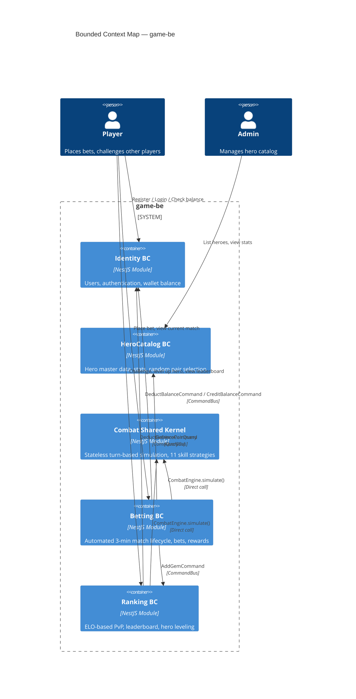
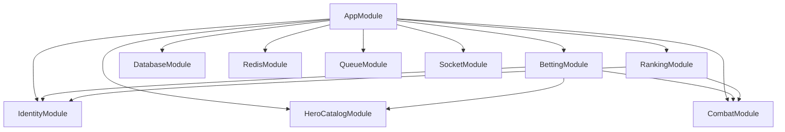
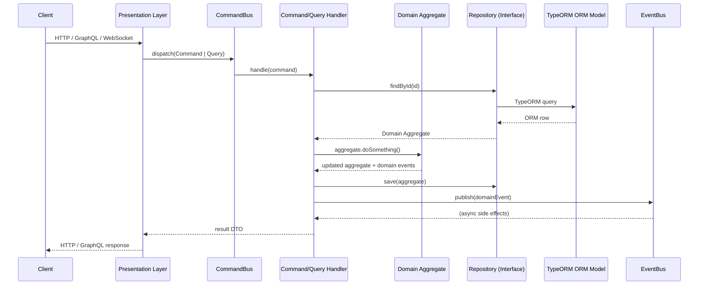
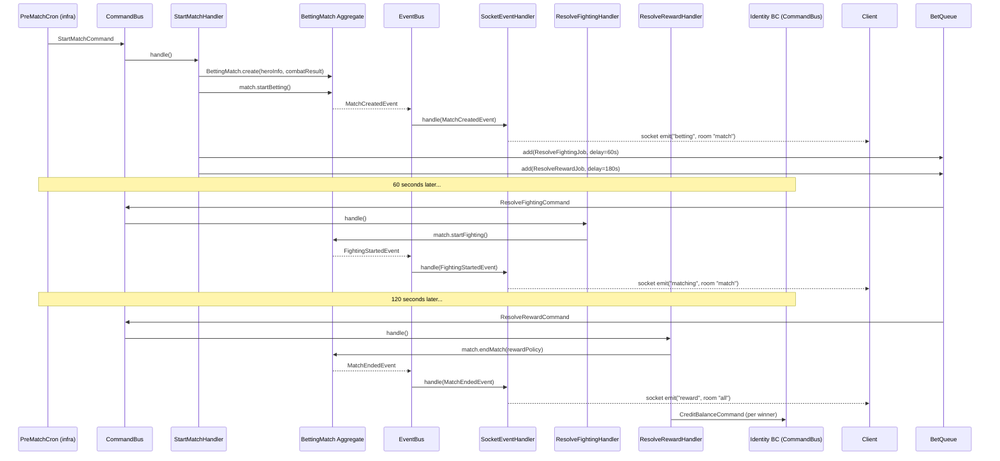
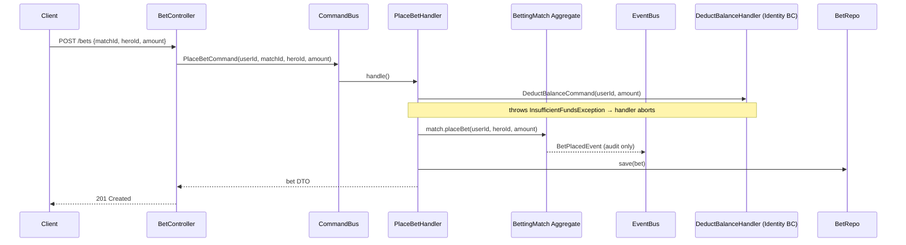
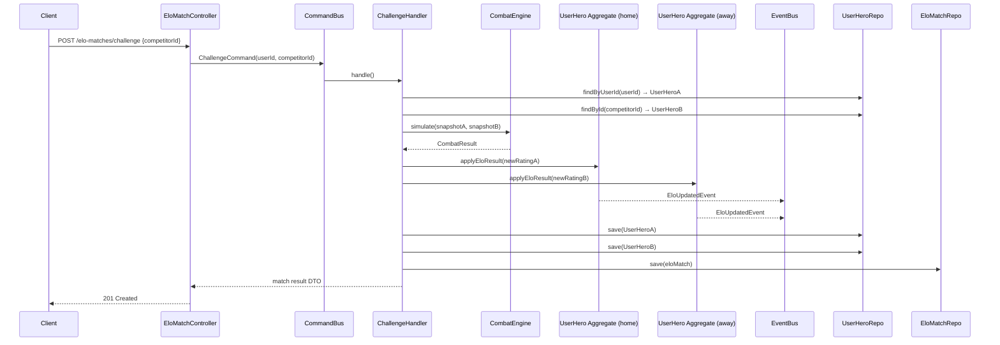
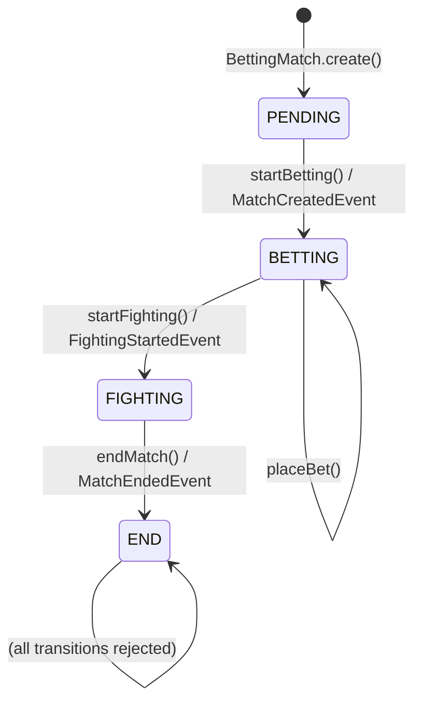

# Design Document — DDD Refactor of `game-be`

## Overview

This document describes the technical design for restructuring the `game-be` NestJS backend from a flat monolith into a Domain-Driven Design (DDD) architecture with four Bounded Contexts and one Shared Kernel. The existing codebase registers every provider and controller in a single `AppModule`, mixes TypeORM decorators with GraphQL decorators in the same entity class, and duplicates the entire turn-based combat simulation loop in both `RoundService` and `EloMatchService`. This design eliminates those problems by enforcing strict layer boundaries, introducing CQRS via `@nestjs/cqrs`, and extracting a stateless `CombatEngine`.

No database schema changes are required; the same table names and column layout are preserved throughout.

---

## Architecture

### High-Level Bounded Context Map



### Module Dependency Graph



### Request Flow — CQRS



---

## Components and Interfaces

### Complete Folder Structure

```
src/
├── modules/
│   ├── identity/
│   │   ├── domain/
│   │   │   ├── aggregates/
│   │   │   │   └── user.aggregate.ts
│   │   │   ├── value-objects/
│   │   │   │   ├── wallet.vo.ts
│   │   │   │   └── email.vo.ts
│   │   │   ├── events/
│   │   │   │   └── user-registered.event.ts
│   │   │   ├── exceptions/
│   │   │   │   └── insufficient-funds.exception.ts
│   │   │   ├── repositories/
│   │   │   │   └── user.repository.interface.ts
│   │   │   └── services/
│   │   │       └── password-hasher.service.ts
│   │   ├── application/
│   │   │   ├── commands/
│   │   │   │   ├── register-user/
│   │   │   │   │   ├── register-user.command.ts
│   │   │   │   │   └── register-user.handler.ts
│   │   │   │   ├── login/
│   │   │   │   │   ├── login.command.ts
│   │   │   │   │   └── login.handler.ts
│   │   │   │   ├── deduct-balance/
│   │   │   │   │   ├── deduct-balance.command.ts
│   │   │   │   │   └── deduct-balance.handler.ts
│   │   │   │   └── credit-balance/
│   │   │   │       ├── credit-balance.command.ts
│   │   │   │       └── credit-balance.handler.ts
│   │   │   └── queries/
│   │   │       ├── get-user/
│   │   │       │   ├── get-user.query.ts
│   │   │       │   └── get-user.handler.ts
│   │   │       └── get-user-by-email/
│   │   │           ├── get-user-by-email.query.ts
│   │   │           └── get-user-by-email.handler.ts
│   │   ├── infrastructure/
│   │   │   ├── auth/
│   │   │   │   ├── jwt.strategy.ts
│   │   │   │   ├── jwt.guard.ts
│   │   │   │   └── roles.guard.ts
│   │   │   └── persistence/typeorm/
│   │   │       ├── user.orm-entity.ts
│   │   │       └── user.repository.ts
│   │   ├── presentation/
│   │   │   ├── http/
│   │   │   │   └── auth.controller.ts
│   │   │   └── graphql/
│   │   │       └── auth.resolver.ts
│   │   └── identity.module.ts
│   │
│   ├── hero-catalog/
│   │   ├── domain/
│   │   │   ├── aggregates/
│   │   │   │   └── hero.aggregate.ts
│   │   │   ├── value-objects/
│   │   │   │   └── hero-stats.vo.ts
│   │   │   └── repositories/
│   │   │       └── hero.repository.interface.ts
│   │   ├── application/
│   │   │   └── queries/
│   │   │       ├── get-hero/
│   │   │       │   ├── get-hero.query.ts
│   │   │       │   └── get-hero.handler.ts
│   │   │       ├── get-hero-pair/
│   │   │       │   ├── get-hero-pair.query.ts
│   │   │       │   └── get-hero-pair.handler.ts
│   │   │       └── list-heroes/
│   │   │           ├── list-heroes.query.ts
│   │   │           └── list-heroes.handler.ts
│   │   ├── infrastructure/
│   │   │   └── persistence/typeorm/
│   │   │       ├── hero.orm-entity.ts
│   │   │       └── hero.repository.ts
│   │   ├── presentation/
│   │   │   └── http/
│   │   │       └── hero.controller.ts
│   │   └── hero-catalog.module.ts
│   │
│   ├── combat/                           # Shared Kernel — no aggregates, no domain events
│   │   ├── domain/
│   │   │   ├── value-objects/
│   │   │   │   ├── hero-snapshot.vo.ts
│   │   │   │   ├── combat-result.vo.ts
│   │   │   │   └── turn-log.vo.ts
│   │   │   ├── exceptions/
│   │   │   │   └── unknown-hero-skill.exception.ts
│   │   │   └── skills/
│   │   │       ├── skill.strategy.interface.ts
│   │   │       ├── hell.skill.ts
│   │   │       ├── sphinx.skill.ts
│   │   │       ├── darklord.skill.ts
│   │   │       ├── valkyrie.skill.ts
│   │   │       ├── poseidon.skill.ts
│   │   │       ├── phoenix.skill.ts
│   │   │       ├── chiron.skill.ts
│   │   │       ├── hera.skill.ts
│   │   │       ├── fenrir.skill.ts
│   │   │       ├── amon.skill.ts
│   │   │       └── nezha.skill.ts
│   │   ├── services/
│   │   │   ├── combat-engine.service.ts
│   │   │   └── skill-registry.service.ts
│   │   └── combat.module.ts
│   │
│   ├── betting/
│   │   ├── domain/
│   │   │   ├── aggregates/
│   │   │   │   └── betting-match.aggregate.ts
│   │   │   ├── entities/
│   │   │   │   └── bet.entity.ts
│   │   │   ├── value-objects/
│   │   │   │   ├── bet-amount.vo.ts
│   │   │   │   └── match-status.vo.ts
│   │   │   ├── events/
│   │   │   │   ├── match-created.event.ts
│   │   │   │   ├── fighting-started.event.ts
│   │   │   │   ├── match-ended.event.ts
│   │   │   │   └── bet-placed.event.ts
│   │   │   ├── exceptions/
│   │   │   │   ├── invalid-match-transition.exception.ts
│   │   │   │   └── betting-closed.exception.ts
│   │   │   ├── repositories/
│   │   │   │   ├── betting-match.repository.interface.ts
│   │   │   │   └── bet.repository.interface.ts
│   │   │   └── services/
│   │   │       └── reward-policy.service.ts
│   │   ├── application/
│   │   │   ├── commands/
│   │   │   │   ├── start-match/
│   │   │   │   │   ├── start-match.command.ts
│   │   │   │   │   └── start-match.handler.ts
│   │   │   │   ├── place-bet/
│   │   │   │   │   ├── place-bet.command.ts
│   │   │   │   │   └── place-bet.handler.ts
│   │   │   │   ├── resolve-fighting/
│   │   │   │   │   ├── resolve-fighting.command.ts
│   │   │   │   │   └── resolve-fighting.handler.ts
│   │   │   │   └── resolve-reward/
│   │   │   │       ├── resolve-reward.command.ts
│   │   │   │       └── resolve-reward.handler.ts
│   │   │   └── queries/
│   │   │       ├── get-current-match/
│   │   │       ├── get-match-history/
│   │   │       ├── get-bet-by-user-and-match/
│   │   │       └── get-match-statistics/
│   │   ├── infrastructure/
│   │   │   ├── persistence/typeorm/
│   │   │   │   ├── betting-match.orm-entity.ts
│   │   │   │   ├── betting-match.repository.ts
│   │   │   │   ├── bet.orm-entity.ts
│   │   │   │   └── bet.repository.ts
│   │   │   └── jobs/
│   │   │       ├── pre-match.cron.ts
│   │   │       └── bet.consumer.ts
│   │   ├── presentation/
│   │   │   └── http/
│   │   │       ├── bet.controller.ts
│   │   │       └── match.controller.ts
│   │   └── betting.module.ts
│   │
│   └── ranking/
│       ├── domain/
│       │   ├── aggregates/
│       │   │   └── user-hero.aggregate.ts
│       │   ├── entities/
│       │   │   └── elo-match.entity.ts
│       │   ├── value-objects/
│       │   │   └── elo-rating.vo.ts
│       │   ├── events/
│       │   │   └── elo-updated.event.ts
│       │   ├── exceptions/
│       │   │   └── exceeds-level-cap.exception.ts
│       │   └── repositories/
│       │       ├── user-hero.repository.interface.ts
│       │       └── elo-match.repository.interface.ts
│       ├── application/
│       │   ├── commands/
│       │   │   ├── challenge/
│       │   │   ├── level-up-user-hero/
│       │   │   └── allocate-points/
│       │   └── queries/
│       │       ├── get-leaderboard/
│       │       ├── get-user-hero/
│       │       └── get-elo-match-history/
│       ├── infrastructure/
│       │   └── persistence/typeorm/
│       │       ├── user-hero.orm-entity.ts
│       │       ├── user-hero.repository.ts
│       │       ├── elo-match.orm-entity.ts
│       │       └── elo-match.repository.ts
│       └── ranking.module.ts
│
├── shared/
│   ├── constants/
│   │   ├── bet-status.constant.ts
│   │   ├── name-queue.constant.ts
│   │   └── gem-drop.constant.ts
│   ├── infrastructure/
│   │   ├── socket/
│   │   │   └── socket.gateway.ts
│   │   └── redis/
│   │       └── redis.module.ts
│   └── pipes/
│       └── validation.pipe.ts
│
└── app.module.ts
```

### Key Interface Signatures

#### Identity BC

```typescript
// domain/repositories/user.repository.interface.ts
export const USER_REPOSITORY = Symbol('IUserRepository');

export interface IUserRepository {
  findById(id: number): Promise<User | null>;
  findByEmail(email: string): Promise<User | null>;
  save(user: User): Promise<User>;
}

// domain/aggregates/user.aggregate.ts
export class User extends AggregateRoot {
  constructor(
    public readonly id: number,
    public readonly email: string,
    private passwordHash: string,
    public readonly role: RoleEnum,
    public readonly confirmedEmail: boolean,
    private wallet: Wallet,
  ) { super(); }

  static create(id: number, email: string, passwordHash: string): User;
  deductBalance(amount: number): void;    // calls wallet.deduct(), records event
  creditBalance(amount: number): void;    // calls wallet.credit(), records event
  getBalance(): number;
}

// domain/value-objects/wallet.vo.ts
export class Wallet {
  constructor(private readonly balance: number) {}

  deduct(amount: number): Wallet;         // returns new Wallet; throws InsufficientFundsException
  credit(amount: number): Wallet;         // returns new Wallet
  getBalance(): number;
}

// application/commands/deduct-balance/deduct-balance.command.ts
export class DeductBalanceCommand {
  constructor(
    public readonly userId: number,
    public readonly amount: number,
  ) {}
}

// application/commands/credit-balance/credit-balance.command.ts
export class CreditBalanceCommand {
  constructor(
    public readonly userId: number,
    public readonly amount: number,
  ) {}
}
```

#### HeroCatalog BC

```typescript
// domain/repositories/hero.repository.interface.ts
export const HERO_REPOSITORY = Symbol('IHeroRepository');

export interface IHeroRepository {
  findById(id: number): Promise<Hero | null>;
  findByName(name: string): Promise<Hero | null>;
  getPair(): Promise<[Hero, Hero]>;
  listAll(): Promise<Hero[]>;
}

// domain/aggregates/hero.aggregate.ts
export class Hero {
  constructor(
    public readonly id: number,
    public readonly name: string,
    public readonly element: string,
    public readonly position: string,
    public readonly story: string,
    public readonly guide: string,
    public readonly skill: string,
    public readonly stats: HeroStats,
  ) {}
}

// domain/value-objects/hero-stats.vo.ts
export class HeroStats {
  constructor(
    public readonly hp: number,
    public readonly atk: number,
    public readonly def: number,
    public readonly spd: number,
    public readonly critRate: number,
    public readonly critDmg: number,
    public readonly atkHealing: number,
    public readonly takeDmgHealing: number,
    public readonly dodge: number,
    public readonly acc: number,
    public readonly cc: number,
    public readonly effectResistance: number,
    public readonly intrinsicStatus: number,
  ) {}
}
```

#### Combat Shared Kernel

```typescript
// domain/skills/skill.strategy.interface.ts
export interface SkillStrategy {
  apply(
    attacker: HeroSnapshot,
    defender: HeroSnapshot,
  ): [HeroSnapshot, HeroSnapshot];
}

// domain/value-objects/hero-snapshot.vo.ts
// Immutable — all properties are readonly. CombatEngine creates copies for mutation.
export class HeroSnapshot {
  constructor(
    public readonly id: number,
    public readonly name: string,
    public readonly hp: number,
    public readonly atk: number,
    public readonly def: number,
    public readonly spd: number,
    public readonly critRate: number,
    public readonly critDmg: number,
    public readonly atkHealing: number,
    public readonly takeDmgHealing: number,
    public readonly dodge: number,
    public readonly acc: number,
    public readonly cc: number,
    public readonly effectResistance: number,
    public readonly intrinsicStatus: number,
  ) {}

  // Factory for use inside CombatEngine to create a mutable working copy
  withHp(hp: number): HeroSnapshot;
  withAtk(atk: number): HeroSnapshot;
  // ... (builder methods for each field that changes during simulation)
}

// domain/value-objects/combat-result.vo.ts
export class CombatResult {
  constructor(
    public readonly winnerId: number,
    public readonly loserId: number,
    public readonly turns: TurnLog[],
    public readonly turnNumber: number,
  ) {}
}

// domain/value-objects/turn-log.vo.ts
export class TurnLog {
  constructor(
    public readonly turnNumber: number,
    public readonly attackerId: number,
    public readonly defenderId: number,
    public readonly damage: number,
    public readonly skillDamage: number,
    public readonly attackerHpAfter: number,
    public readonly defenderHpAfter: number,
    public readonly isCrit: boolean,
    public readonly isActiveSkill: boolean,
  ) {}
}

// services/combat-engine.service.ts
@Injectable()
export class CombatEngine {
  constructor(private readonly skillRegistry: SkillRegistry) {}

  // All state is local. No instance variables.
  simulate(home: HeroSnapshot, away: HeroSnapshot): CombatResult;
}

// services/skill-registry.service.ts
@Injectable()
export class SkillRegistry {
  private readonly registry: Map<string, SkillStrategy>;

  get(heroName: string): SkillStrategy;  // throws UnknownHeroSkillException if not found
}
```

#### Betting BC

```typescript
// domain/repositories/betting-match.repository.interface.ts
export const BETTING_MATCH_REPOSITORY = Symbol('IBettingMatchRepository');

export interface IBettingMatchRepository {
  findById(id: number): Promise<BettingMatch | null>;
  save(match: BettingMatch): Promise<BettingMatch>;
  findCurrentMatchId(): Promise<number | null>;
}

// domain/repositories/bet.repository.interface.ts
export const BET_REPOSITORY = Symbol('IBetRepository');

export interface IBetRepository {
  findByMatchAndHero(matchId: number, heroId: number): Promise<Bet[]>;
  findByMatchAndUser(matchId: number, userId: number): Promise<Bet | null>;
}

// domain/aggregates/betting-match.aggregate.ts
export class BettingMatch extends AggregateRoot {
  private status: MatchStatus;
  private bets: Bet[];
  private combatResult: CombatResult;

  static create(heroInfo: HeroSnapshot[], combatResult: CombatResult): BettingMatch;

  startBetting(): void;      // PENDING → BETTING; publishes MatchCreatedEvent
  startFighting(): void;     // BETTING → FIGHTING; publishes FightingStartedEvent
  endMatch(policy: RewardPolicy): void;  // FIGHTING → END; publishes MatchEndedEvent

  placeBet(userId: number, heroId: number, amount: number): void;
  // throws BettingClosedException if status !== BETTING
  // throws if user already placed a bet this match
  // publishes BetPlacedEvent
}

// domain/services/reward-policy.service.ts
export class RewardPolicy {
  calculatePayouts(bets: Bet[], winnerId: number): Map<number, number>;
  // returns map of userId → payout (bet.balance × 2)
  // total entries: winning bets only
  // invariant: sum(payouts.values()) <= sum(winning bet balances) × 2

  shouldDropGem(): boolean;
  // uses existing drop-chance constant
}
```

#### Ranking BC

```typescript
// domain/value-objects/elo-rating.vo.ts
export class EloRating {
  constructor(private readonly value: number) {}

  static initial(): EloRating;  // returns EloRating(1600)

  recalculate(opponentRating: EloRating, outcome: 1 | 0): EloRating;
  // uses @studimax/elo with kFactor: 20
  // returns NEW EloRating; original is unchanged

  getValue(): number;
}

// domain/aggregates/user-hero.aggregate.ts
export class UserHero extends AggregateRoot {
  constructor(
    public readonly id: number,
    public readonly userId: number,
    public readonly heroId: number,
    private level: number,
    private atkPoint: number,
    private defPoint: number,
    private hpPoint: number,
    private spdPoint: number,
    private critRatePoint: number,
    private eloRating: EloRating,
    // computed combat stats derived from hero base + skill points
    public readonly stats: HeroStats,
  ) { super(); }

  levelUp(): void;
  // throws if deduct cost not met (caller dispatches DeductBalanceCommand first)

  allocatePoints(atk: number, def: number, hp: number, spd: number, critRate: number): void;
  // throws ExceedsLevelCapException if atk + def + hp + spd + critRate > this.level

  applyEloResult(newRating: EloRating): void;
  // publishes EloUpdatedEvent
}

// domain/repositories/user-hero.repository.interface.ts
export const USER_HERO_REPOSITORY = Symbol('IUserHeroRepository');

export interface IUserHeroRepository {
  findById(id: number): Promise<UserHero | null>;
  findByUserId(userId: number): Promise<UserHero | null>;
  save(userHero: UserHero): Promise<UserHero>;
  findLeaderboard(options: { page: number; limit: number }): Promise<UserHero[]>;
}
```

---

## Data Models

### Domain → ORM Mapping

Each Bounded Context has its own ORM model classes under `infrastructure/persistence/typeorm/`. These are plain TypeORM `@Entity` classes that never appear in domain or application code. The repository implementation performs the mapping in both directions.

### ORM Models (table binding — schema unchanged)

```typescript
// identity: users table
@Entity('users')
export class UserOrmEntity {
  @PrimaryGeneratedColumn() id: number;
  @Column() email: string;
  @Column() password: string;             // stored as bcrypt hash
  @Column({ type: 'enum', enum: RoleEnum }) role: RoleEnum;
  @Column({ default: false }) confirmed: boolean;
  @Column({ type: 'decimal', default: 0 }) balance: number;
  @Column({ type: 'decimal', default: 0 }) available_balance: number;
  @Column({ nullable: true }) firstName: string;
  @Column({ nullable: true }) lastName: string;
  @Column({ nullable: true }) phoneNumber: string;
  @Column({ nullable: true }) avatar: string;
  @CreateDateColumn() createdAt: Date;
  @UpdateDateColumn() updatedAt: Date;
}

// hero-catalog: heroes table
@Entity('heroes')
export class HeroOrmEntity {
  @PrimaryGeneratedColumn() id: number;
  @Column() name: string;
  @Column() element: string;
  @Column() position: string;
  @Column({ type: 'text' }) story: string;
  @Column({ type: 'text' }) guide: string;
  @Column({ type: 'text', nullable: true }) skill: string;
  @Column({ default: 0 }) hp: number;
  @Column({ default: 0 }) atk: number;
  @Column({ default: 0 }) def: number;
  @Column({ default: 0 }) spd: number;
  @Column({ default: 0 }) crit_rate: number;
  @Column({ default: 0 }) crit_dmg: number;
  @Column({ default: 0 }) atk_healing: number;
  @Column({ default: 0 }) take_dmg_healing: number;
  @Column({ default: 0 }) dodge: number;
  @Column({ default: 0 }) acc: number;
  @Column({ default: 0 }) cc: number;
  @Column({ default: 0 }) effect_resistance: number;
  @Column({ default: 0 }) intrinsic_status: number;
  @CreateDateColumn() createdAt: Date;
  @UpdateDateColumn() updatedAt: Date;
}

// betting: matches table
@Entity('matches')
export class BettingMatchOrmEntity {
  @PrimaryGeneratedColumn() id: number;
  @Column({ type: 'json', nullable: true }) hero_info: string;
  @Column({ type: 'json', nullable: true }) turns: string;
  @Column({ type: 'varchar', nullable: true }) start_time: string;
  @Column({ default: 0 }) turn_number: number;
  @Column({ default: 0 }) status: number;
  @Column({ default: 0 }) winner: number;
  @Column({ default: 0 }) loser: number;
  @Column({ default: 0 }) type: number;
  @CreateDateColumn() createdAt: Date;
  @UpdateDateColumn() updatedAt: Date;
}

// betting: bets table
@Entity('bets')
export class BetOrmEntity {
  @PrimaryGeneratedColumn() id: number;
  @Column() user_id: number;
  @Column() match_id: number;
  @Column() hero_id: number;
  @Column({ type: 'decimal', default: 0 }) balance: number;
  @Column({ type: 'boolean', default: false }) result: boolean;
  @CreateDateColumn() createdAt: Date;
  @UpdateDateColumn() updatedAt: Date;
}

// ranking: user_heroes table
@Entity('user_heroes')
export class UserHeroOrmEntity {
  @PrimaryGeneratedColumn() id: number;
  @Column() user_id: number;
  @Column() hero_id: number;
  @Column({ default: 0 }) level: number;
  @Column({ default: 0 }) atk_point: number;
  @Column({ default: 0 }) def_point: number;
  @Column({ default: 0 }) hp_point: number;
  @Column({ default: 0 }) spd_point: number;
  @Column({ default: 0 }) crit_rate_point: number;
  @Column({ default: 1600 }) elo: number;
  // All hero stat columns (atk, def, hp, spd, etc.) preserved from existing schema
  @CreateDateColumn() createdAt: Date;
  @UpdateDateColumn() updatedAt: Date;
}

// ranking: elo-matches table
@Entity('elo-matches')
export class EloMatchOrmEntity {
  // Same shape as matches table (extends same column set)
  @PrimaryGeneratedColumn() id: number;
  @Column({ type: 'json', nullable: true }) hero_info: string;
  @Column({ type: 'json', nullable: true }) turns: string;
  @Column({ type: 'varchar', nullable: true }) start_time: string;
  @Column({ default: 0 }) turn_number: number;
  @Column({ default: 0 }) status: number;
  @Column({ default: 0 }) winner: number;
  @Column({ default: 0 }) loser: number;
  @Column({ default: 0 }) type: number;
  @CreateDateColumn() createdAt: Date;
  @UpdateDateColumn() updatedAt: Date;
}

// ranking: user_gems table
@Entity('user_gems')
export class UserGemOrmEntity {
  @PrimaryGeneratedColumn() id: number;
  @Column() user_id: number;
  @Column({ type: 'varchar' }) type: string;
  @Column() level: number;
  @Column({ default: 0 }) available_num: number;
  @Column({ default: 0 }) attached_num: number;
  @CreateDateColumn({ name: 'created_at' }) createdAt: Date;
  @UpdateDateColumn({ name: 'updated_at' }) updatedAt: Date;
}
```

### Repository Mapping Pattern

```typescript
// Example: identity/infrastructure/persistence/typeorm/user.repository.ts
@Injectable()
export class TypeOrmUserRepository implements IUserRepository {
  constructor(
    @InjectRepository(UserOrmEntity)
    private readonly orm: Repository<UserOrmEntity>,
  ) {}

  async findById(id: number): Promise<User | null> {
    const row = await this.orm.findOne({ where: { id } });
    return row ? this.toDomain(row) : null;
  }

  async save(user: User): Promise<User> {
    const row = this.toOrm(user);
    const saved = await this.orm.save(row);
    return this.toDomain(saved);
  }

  private toDomain(row: UserOrmEntity): User {
    return new User(
      row.id,
      row.email,
      row.password,
      row.role,
      row.confirmed,
      new Wallet(Number(row.balance)),
    );
  }

  private toOrm(user: User): UserOrmEntity {
    const row = new UserOrmEntity();
    row.id = user.id;
    row.email = user.email;
    row.balance = user.getBalance();
    // ... remaining fields
    return row;
  }
}
```

---

## Domain Event Flow

### BettingMatch Lifecycle



### Cross-Context PlaceBet Flow



### Challenge (ELO PvP) Flow



---

## CombatEngine Design

The `CombatEngine.simulate` method holds **no instance state**. All variables are local to the call frame, which makes concurrent simulation safe with no locking.

```typescript
// Pseudo-implementation sketch (not prescriptive for exact variable names)
simulate(homeSnap: HeroSnapshot, awaySnap: HeroSnapshot): CombatResult {
  // Working copies — HeroSnapshot.withHp() etc. return new instances
  let home = homeSnap;
  let away = awaySnap;
  const turns: TurnLog[] = [];
  let turnNumber = 1;

  while (home.hp > 0 && away.hp > 0 && turnNumber <= 20) {
    const faster = home.spd >= away.spd ? home : away;
    const slower = faster === home ? away : home;

    [home, away] = this.executeTurn(faster, slower, turnNumber, turns);
    if (home.hp > 0 && away.hp > 0) {
      [home, away] = this.executeTurn(slower, faster, turnNumber, turns);
    }
    turnNumber++;
  }

  const winner = home.hp >= away.hp ? homeSnap : awaySnap;
  const loser  = winner === homeSnap ? awaySnap : homeSnap;

  return new CombatResult(winner.id, loser.id, turns, turnNumber - 1);
}
```

The key behavioral invariant is that `homeSnap` and `awaySnap` are **never mutated**. `executeTurn` applies skill effects by calling `SkillStrategy.apply`, which also returns new `HeroSnapshot` instances rather than mutating its arguments.

### Skill Strategy Pattern (replaces switch/case in SkillFactory)

```typescript
// Registration in SkillRegistry (via NestJS constructor injection)
this.registry = new Map([
  ['Hell',      new HellSkill()],
  ['Sphinx',    new SphinxSkill()],
  ['Darklord',  new DarklordSkill()],
  ['Valkyrie',  new ValkyrieSkill()],
  ['Poseidon',  new PoseidonSkill()],
  ['Phoenix',   new PhoenixSkill()],
  ['Chiron',    new ChironSkill()],
  ['Hera',      new HeraSkill()],
  ['Fenrir',    new FenrirSkill()],
  ['Amon',      new AmonSkill()],
  ['Nezha',     new NezhaSkill()],
]);
```

Each `SkillStrategy` implementation is a pure function wrapped in a class. It takes two `HeroSnapshot`s and returns two new `HeroSnapshot`s with modified stats. The logic is ported directly from `SkillService` static methods.

---

## BettingMatch State Machine



The status values map to the existing `BetStatusConstant` enum (`PENDING=0`, `BETTING=1`, `FIGHTING=2`, `END=3`) so the numeric values in the `matches` table are unchanged.

Any call to `startBetting()`, `startFighting()`, or `endMatch()` on a match that is not in the correct predecessor state throws `InvalidMatchTransitionException`.

---

## AppModule (Shell)

```typescript
@Module({
  imports: [
    ConfigModule.forRoot({ isGlobal: true }),
    ScheduleModule.forRoot(),
    DatabaseModule,       // TypeORM setup
    RedisModule,          // nestjs-redis
    QueueModule,          // BullModule with 'socket.io' + 'bet' queues
    SocketModule,         // SocketGateway + socket.io-redis adapter
    IdentityModule,
    HeroCatalogModule,
    BettingModule,
    RankingModule,
    CombatModule,
  ],
  // zero providers
})
export class AppModule {}
```

---

## Correctness Properties

*A property is a characteristic or behavior that should hold true across all valid executions of a system — essentially, a formal statement about what the system should do. Properties serve as the bridge between human-readable specifications and machine-verifiable correctness guarantees.*

The property-based testing library for this TypeScript/NestJS project is **[fast-check](https://fast-check.dev/)**, which provides generators for arbitrary inputs and runs each property a minimum of 100 times with shrinking on failure.

---

### Property 1: CombatEngine Termination

*For any* valid pair of `HeroSnapshot` inputs, `CombatEngine.simulate` SHALL return a `CombatResult` whose `turnNumber` is in the range `[1, 20]` inclusive.

**Validates: Requirements 6.2, 6.10, 13.1**

---

### Property 2: CombatEngine Input Immutability

*For any* valid pair of `HeroSnapshot` inputs, calling `CombatEngine.simulate(home, away)` SHALL leave both `home` and `away` structurally unchanged — every field on both snapshots must be identical before and after the call.

**Validates: Requirements 6.3, 12.1**

---

### Property 3: CombatEngine Simulation Symmetry

*For any* valid pair of `HeroSnapshot` inputs where both heroes have distinct `spd` values, `CombatEngine.simulate(A, B)` and `CombatEngine.simulate(B, A)` SHALL produce a `CombatResult` with the same `winnerId` (the same hero wins regardless of which is passed as `home`).

**Validates: Requirements 12.4**

---

### Property 4: BettingMatch Monotonic State

*For any* `BettingMatch` instance, applying any sequence of valid lifecycle transitions SHALL produce a `status` that never decreases numerically. Additionally, *for any* `BettingMatch` with `status = END`, every subsequent call to `startBetting()`, `startFighting()`, or `endMatch()` SHALL throw `InvalidMatchTransitionException`.

**Validates: Requirements 7.1, 13.2**

---

### Property 5: Wallet Immutability

*For any* `Wallet` instance `w` and any non-negative integer `amount`, calling `w.deduct(amount)` or `w.credit(amount)` SHALL return a new `Wallet` instance distinct from `w`, and `w.getBalance()` SHALL be unchanged after the call.

**Validates: Requirements 4.2**

---

### Property 6: Wallet Insufficient Funds Guard

*For any* `Wallet` with balance `b` and any `amount` strictly greater than `b`, calling `w.deduct(amount)` SHALL throw `InsufficientFundsException`, and `w.getBalance()` SHALL still equal `b` after the throw.

**Validates: Requirements 4.3**

---

### Property 7: Wallet Balance Conservation

*For any* initial `Wallet` balance and any sequence of `credit` and `deduct` operations where no `deduct` call exceeds the running balance, the final balance SHALL equal `initialBalance + sum(creditAmounts) − sum(deductAmounts)`.

**Validates: Requirements 13.3**

---

### Property 8: EloRating Conservation

*For any* pair of numeric ELO ratings `(homeRating, awayRating)` and any binary outcome `(1 | 0)`, after calling `EloRating.recalculate` for both heroes the absolute difference between `(homeRating + awayRating)` and `(newHomeRating + newAwayRating)` SHALL be less than or equal to the `kFactor` of 20.

**Validates: Requirements 8.2, 8.8, 13.4**

---

### Property 9: RewardPolicy No-Money-Creation

*For any* list of `Bet` objects and any `winnerId`, the total payout computed by `RewardPolicy.calculatePayouts` SHALL be less than or equal to the sum of all bets on the winning hero multiplied by 2.

**Validates: Requirements 7.8, 13.5**

---

### Property 10: UserHero Level Cap Enforcement

*For any* `UserHero` with level `L` and any point allocation `(atk, def, hp, spd, critRate)` where `atk + def + hp + spd + critRate > L`, calling `userHero.allocatePoints(atk, def, hp, spd, critRate)` SHALL throw `ExceedsLevelCapException` and SHALL NOT mutate the `UserHero` state.

**Validates: Requirements 8.3**

---

## Error Handling

### Domain Exceptions

Each Bounded Context defines its own domain exceptions in `domain/exceptions/`. These are plain TypeScript classes — no NestJS decorators — that extend `Error`. The application layer re-throws them unchanged; the presentation layer maps them to HTTP status codes.

| Exception | BC | HTTP Status | Trigger |
|---|---|---|---|
| `InsufficientFundsException` | Identity | 409 Conflict | `Wallet.deduct` amount > balance |
| `InvalidMatchTransitionException` | Betting | 409 Conflict | Illegal state machine transition |
| `BettingClosedException` | Betting | 409 Conflict | `placeBet` on non-BETTING match |
| `UnknownHeroSkillException` | Combat | 500 Internal | Hero name not in SkillRegistry |
| `ExceedsLevelCapException` | Ranking | 422 Unprocessable | Skill points exceed level |

### Cross-Context Error Propagation

When a command handler in Betting dispatches `DeductBalanceCommand` to Identity and that command throws `InsufficientFundsException`, the exception propagates up the call stack without wrapping. The `PlaceBetHandler` catches it, ensures no `Bet` was persisted, and re-throws it to the presentation layer.

### Infrastructure Errors

TypeORM errors (connection failures, constraint violations) are caught in repository implementations and wrapped in a `PersistenceException` before surfacing to the application layer. This isolates domain code from ORM-specific error types.

---

## Testing Strategy

### Unit Tests

Unit tests cover specific examples, edge cases, and error conditions:
- Each command handler tested with mocked repository interfaces
- Each query handler tested with mocked repository interfaces
- Each domain aggregate's state machine transitions
- Domain exceptions thrown at correct boundaries
- Mapper functions in repository implementations (ORM → domain, domain → ORM)

Unit tests should **not** cover generic input variation — that is left to property tests.

### Property-Based Tests (fast-check, min 100 iterations per property)

Each property in the Correctness Properties section above maps to exactly one property-based test. Test tagging convention:

```typescript
// Tag format for each test:
// Feature: ddd-refactor, Property N: <property title>

// Example:
it('Feature: ddd-refactor, Property 1: CombatEngine Termination', () => {
  fc.assert(
    fc.property(heroSnapshotArb, heroSnapshotArb, (home, away) => {
      const result = engine.simulate(home, away);
      expect(result.turnNumber).toBeGreaterThanOrEqual(1);
      expect(result.turnNumber).toBeLessThanOrEqual(20);
    }),
    { numRuns: 100 }
  );
});
```

**Generators to implement:**
- `heroSnapshotArb`: generates `HeroSnapshot` with valid stat ranges (hp > 0, atk > 0, def ≥ 0, spd > 0, etc.)
- `walletArb`: generates `Wallet` with balance in `[0, 1_000_000]`
- `betListArb`: generates a list of `Bet` objects with positive balances and hero IDs
- `eloRatingArb`: generates numeric ELO values in `[0, 3000]`
- `matchStatusSequenceArb`: generates sequences from the valid transition alphabet

### Integration Tests

Integration tests (1–3 examples each) cover infrastructure wiring that PBT cannot:
- TypeORM repository implementations against a test MySQL database
- Bull queue job scheduling and consumption
- Socket.IO event emission through the gateway
- JWT strategy and guard behavior end-to-end

### Test File Locations

Property and unit tests live alongside the code they test, following NestJS convention:
```
src/modules/combat/services/combat-engine.service.spec.ts
src/modules/identity/domain/value-objects/wallet.vo.spec.ts
src/modules/betting/domain/aggregates/betting-match.aggregate.spec.ts
src/modules/ranking/domain/value-objects/elo-rating.vo.spec.ts
src/modules/betting/domain/services/reward-policy.service.spec.ts
src/modules/ranking/domain/aggregates/user-hero.aggregate.spec.ts
```
