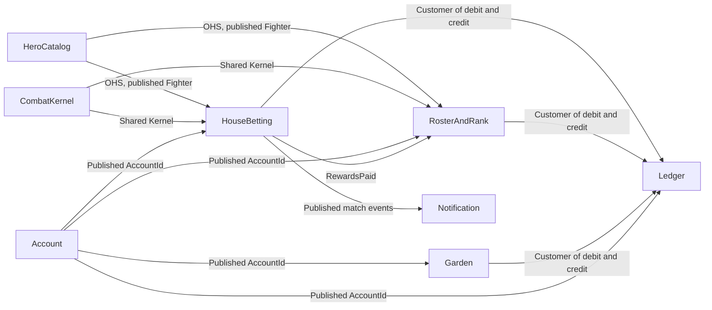

# Strategic Design — bet-herox

This document fixes the business model before aggregates, commands, or folders. The tactical design in [design.md](./design.md) must follow the contexts and language defined here. When the two disagree, change the tactical design.

Scope is the product that exists in code, plus the short notes in `src/app/README.md`. This refactor does not change the MySQL schema. Renaming columns comes later, after the language is stable.

## 1. The business

bet-herox is a game in which players watch two heroes fight and stake on the winner. The main loop:

1. The system picks two hero templates and simulates the fight to completion (at most 20 turns).
2. The result stays hidden. Players place stakes while the betting window is open.
3. The fight is revealed. A stake on the winning hero pays `amount × 2`.

Supporting loops that already have code:

- Ranked challenge between two heroes owned by players, scored with Elo.
- Planting a tree, harvesting it over time, and raiding someone else's tree.
- A gem drop after a winning stake, then attaching and leveling that gem on an owned hero.
- An auto-stake policy per hero pair.

Described in the README, with no working model:

- Destroyer: a duel, win pays `×2`, loss takes 10% of money.
- Fortune (Thần tài): a random credit of 1.1–1.5× money.
- Tower and guild: entity files only. All three files `tower-match`, `guild-match`, and `elo-match` declare `class EloMatchEntity` and `@Entity('elo-matches')`. They are not contexts.

## 2. Domain and subdomains

Invest by how much the subdomain differentiates the product, not by how many tables it has.

### Core Domain

**The house betting match** is the product. Pair templates, hide the result, open the window, take stakes, reveal the fight, settle. The model must enforce:

- One stake per account per match.
- A stake is accepted only while the window is open.
- The stake's money is a `Stake.amount`, not a balance.
- Settlement pays `amount × 2` and only for stakes on the winning template.
- The stored simulation is kept while the public view hides it.

**Combat** is part of the core and is a shared kernel, not a bounded context that knows about money. It holds the 11 traits, turn order by speed, crit, dodge, and the 20-turn cap. The house match and ranked challenge both use it. A trait change is a rule change for both, so the kernel does not import stakes, Elo, or accounts.

The garden does not use the kernel today. `TreeService.rob` only records the raider.

### Supporting subdomains

A supporting subdomain is not automatically its own bounded context.

| Subdomain | Role | Where the model lives |
|---|---|---|
| Hero catalog | Templates and base stats used to pair fights and challenges | Its own context. Read-mostly. No lifecycle |
| Roster and rank | Owned heroes, point allocation, level, Elo, challenges | Its own context. Aggregate `UserHero`. One account has many owned heroes |
| Gems | Inventory, attach, level-up | Inside the roster context. A drop is a reaction to settlement, not a rule of the match |
| Garden | Plant, harvest, raid | Its own context. A raid is not a house stake |
| Auto-stake | Configuration that places a stake for a hero pair | A policy inside the betting context, not a new context |

### Generic subdomains

Wrap a library. Do not invent a new model.

| Subdomain | Use | Does not contain |
|---|---|---|
| Account | Passport, JWT, bcrypt | Balance, heroes, stakes |
| Ledger | Integer `users.balance`, conditional update | The `×2` payout, the 1% plant cost, the level-up fee |
| Notification | Socket.IO, Bull, email, Redis | The decision of when a match is settled |

Money rules belong to the context that states them. The ledger only debits and credits, and it rejects a debit that would go negative.

### Not classified yet

`available_balance` is a column. No use case reads it to make a decision. It is not a term. See section 8.

Destroyer and Fortune are not subdomains until their rules are closed. Do not add an "Events" context to hold README text.

## 3. Ubiquitous language

One term, one meaning, one context. Method names use the verbs below. Do not use `update`, `setStatus`, or `delete` for these actions.

### Account and money

| Term | Meaning | Context |
|---|---|---|
| `Account` | Login identity: email, password, role | Account |
| `AccountId` | Published identifier of an account. Not an event | Shared identifier |
| `Balance` | Money the account holds | Ledger |
| `debit` | Subtract an amount. Fails if the balance is insufficient. Never negative | Ledger |
| `credit` | Add an amount | Ledger |

Today's `User` is both the account and the wallet. Other contexts accept `AccountId` only. They do not import the account aggregate.

### Heroes

| Term | Meaning | Context |
|---|---|---|
| `HeroTemplate` | Catalog row: name, base stats, trait name | Catalog |
| `UserHero` | Owned hero: level, allocated points, Elo, computed stats | Roster |
| `Fighter` | Stats frozen when a simulation starts. Immutable to the caller | Combat |
| `Trait` | The rule for one hero name, applied each turn | Combat |
| `Turn` | One exchange. It can include a blow from each side | Combat |
| `CombatResult` | Winner, loser, turn log, turn count. At most 20 | Combat |

Do not call all three hero concepts `Hero`.

### House betting match

| Term | Meaning |
|---|---|
| `BettingMatch` | The house match that every account can stake on |
| `openBetting` | Start accepting stakes. The result already exists and is not public |
| `reveal` | Close the window and publish the log and the winner. One transition |
| `settle` | Credit stakes that picked the winning template |
| `Stake` | One account, one match, one template, one positive amount |
| `amount` | The stake's money. Never called `balance` |
| `RivalPair` | The two templates in a match, used by the auto-stake policy |
| `chosenHeroId` | The template the auto-stake policy bets on for that pair |

There is no separate `closeBetting` phase. Closing the window and revealing the fight are the same transition.

Legal phases move forward only:

`Scheduled → Betting → Revealing → Settled`

`Scheduled` exists inside `openBetting` before the row is saved. Persisted rows are created already in `Betting`. Do not treat `Scheduled` as a long-lived database state.

Legacy numbers in the `matches.status` column (`PENDING = 0`, `BETTING = 1`, `FIGHTING = 2`, `END = 3`) stay in the mapper. The domain does not call a phase `BetStatus`. `FIGHTING` reads as if the fight were still being calculated. It is not. Simulation finishes before the window opens. Reveal only publishes.

The public `winner` is `0` and the public turn log is empty while the window is open. The internal `CombatResult` stays complete. Those two views do not share one getter.

### Roster and gems

| Term | Meaning |
|---|---|
| `Challenge` | PvP between two `UserHero`s that changes Elo. Not a betting match |
| `allocatePoints` | The sum of allocated points does not exceed level |
| `levelUp` | Debit the fee, then increase level by exactly 1 |
| `EloRating` | Rank score. Initial value 1600 |
| `Gem` | One stat type, with a level, a count in storage, and a count attached |
| `attach` | Move a gem from storage onto a hero |
| `grantGem` | Reaction after `RewardsPaid`, rolled with a chance |

Level-up cost is `2^(currentLevel + 1)`. Level then becomes `currentLevel + 1`. The legacy `UserHeroService.levelUp` pre-increments and then writes `level + 1`, so it persists `currentLevel + 2`. That write is a bug. The rule is +1.

The `user_heroes` table allows many rows per account. `UserHeroRepository.geHeroByUser` uses `findOne`, and the tactical `findByUserId` returns `UserHero | null`. Both collapse a collection to one hero. The language is a collection.

### Garden

| Term | Meaning |
|---|---|
| `Plot` | One planting owned by one account |
| `plant` | Debit 1% of the balance. That amount is `startingValue` |
| `harvest` | The owner is credited for time held |
| `raid` | Another account ends the plot. Not `placeStake` |

Database comments say `0` growing, `1` raided, `2` harvested. The domain words are `Growing`, `Raided`, `Harvested`. `finishedPlanting` writes status `1`, the same value as `rob`. The mapper records that collision. It does not treat `1` as the meaning of harvest. The schema is unchanged in this refactor.

Harvest credit in code is `floor(minutesHeld / 10) × startingValue`. Because `startingValue` is 1% of the balance at plant time, 10 minutes pays that 1% back and 60 minutes pays 6%. That matches the README rate. The code adds this credit on top of a principal that was already debited, so 10 minutes is break-even and 60 minutes is a 6% payout. The README also says an unharvested tree can grow without a cap. The code has no cap.

### Auto-stake

The `auto-bets` row stores `rival_pair`, `hero_id`, `is_enable`, and `bet_percentage` (default 1). `MatchCreatedListener` passes `bet_percentage` as the stake `balance` on `BetService.bet`. The column name says percentage. The only caller treats the number as an absolute amount. Until section 8 is answered, the domain does not define it as a percent of balance.

The listener also builds `rival_pair` from `winner` and `loser`. After the result is hidden those ids are `0`, so the pair is wrong. The pair is the two template ids, taken from the frozen fighters.

### Terms that currently mean more than one thing

| Current word | What it points at | Split into |
|---|---|---|
| `balance` | Account money and stake money | `Balance` and `Stake.amount` |
| `Hero` | Template, owned hero, and fighter | `HeroTemplate`, `UserHero`, `Fighter` |
| `Match` | House match, challenge, raid, tower, guild | `BettingMatch`, `Challenge`, `Raid` |
| `BetStatus` | Phase of a house match | `BettingMatch` phase |
| `User` | Account plus wallet | `Account` and a ledger entry keyed by `AccountId` |
| `Reward` | Close the match, credit money, and roll a gem | `settle`, then `RewardsPaid` |

## 4. Bounded contexts

Each context has one language. Aggregates named here are consistency boundaries, not class designs.

### Combat — shared kernel of the core

The language contains fighters, turns, traits, and results.

Inside: `Fighter`, `Trait` (11 hero names), `Turn`, `CombatResult`, a seedable random source.

Outside: accounts, money, stakes, Elo, plots, the betting window.

Nothing is persisted. Nothing is published as a domain event. Two callers that pass the same seed get the same result. The caller does not mutate the input `Fighter`.

Used by the house match and by challenge. A future raid uses it only if raiding becomes a fight. It does not today.

### House betting — core

In this language, "match" means the house match.

Inside:

- `BettingMatch`: phase, two frozen `Fighter`s, the internal `CombatResult`, and whether the public view is still hidden.
- `Stake`: one `AccountId`, one match, one `HeroTemplateId`, `amount > 0`.
- Auto-stake: configuration by `RivalPair` and `chosenHeroId`. It is not itself a match.

Rules:

- `openBetting` only from `Scheduled`. `reveal` only from `Betting`. `settle` only from `Revealing`. `Settled` accepts no further phase command.
- A stake is placed only while `Betting`. One stake per account per match.
- Debit of `amount` and insert of the stake commit in one transaction. Debit is first inside that transaction. If the debit fails, the transaction rolls back and no stake remains.
- Settlement credits `amount × 2` for each stake whose template id equals the winner. It does not create money outside that formula.
- Reveal does not run the simulation again.

Outside: Elo, level, gems, plots, email, JWT.

### Hero catalog — supporting, upstream

Inside: `HeroTemplate` and base stats.

Outside: combat execution, stakes, ownership.

It publishes a `Fighter` (id, name, and the stats combat needs). It does not publish its own class. Random pairing is a service of this context.

### Roster and rank — supporting

In this language, "hero" means a hero an account owns. Gems live here because they modify that hero.

Inside: `UserHero`, allocated points, level, `EloRating`, `Challenge`, gem inventory.

Rules:

- One account has many `UserHero`s. Lookup by account returns a list.
- The sum of allocated points does not exceed level.
- Level-up debits `2^(currentLevel + 1)` first. If the debit fails, level stays unchanged. On success, level increases by 1.
- Challenge simulates through the shared kernel, then updates both Elo ratings. It does not touch stakes or the house-match phase.

Outside: the betting window, the `×2` payout, planting.

Gem grants are not a command the betting context dispatches. This context listens to `RewardsPaid` and decides whether to grant.

### Garden — supporting

Inside: `Plot`, `plant`, `harvest`, `raid`.

- `plant` debits 1% of the balance at that moment. The amount is `startingValue`.
- `harvest` credits `floor(minutesHeld / 10) × startingValue`.
- `raid` records the raider and ends the plot. The README describes a fight that takes 1% of the opponent's money. The code does not run a fight. Until that rule is confirmed, raid does not reuse `BettingMatch` and does not call combat.

### Ledger — generic

Inside: the money of one `AccountId`, `debit`, `credit`.

The only rule: after every command, the balance is not negative. An insufficient debit is rejected with a ledger error.

The write is one conditional update (`balance = balance ± amount`, and `balance >= amount` on debit). Do not load the balance into memory and overwrite the user row. Name, email, and avatar are not fields of the ledger mapper.

### Account — generic

Inside: registration, login, password hashing, JWT, roles, email confirmation, address.

Outside: every balance change.

Address is an attribute of the account, not a context.

### Notification — generic, no aggregate

Socket, delayed jobs, email. They subscribe to the published language and emit. They do not call business commands, except the scheduler. Cron and Bull are adapters that call `openBetting`, `reveal`, and `settle`.

The code's clock, measured from `openBetting`: reveal after 60 seconds, settle after 180 seconds. The betting window is 60 seconds. The reveal window is 120 seconds. The cron is `0 */3 * * * *`. The README describes a 5-minute cycle with 2 minutes of betting and 3 minutes of watching. Section 8 records that difference. This document does not pick a new clock.

## 5. Context map

### Relationships

**Catalog to house betting, and catalog to roster.** The catalog is upstream, as an Open Host Service. The published language is `Fighter`. Downstream conforms to that contract. It does not import the catalog aggregate. This is not an anti-corruption layer. The upstream model is small and explicit.

**Combat is a shared kernel** of house betting and challenge. It has no business upstream. A trait change needs both consumers. The kernel does not depend on Nest, TypeORM, or Bull.

**House betting, roster, and garden are customers of the ledger.** The ledger is the supplier and the upstream of the money truth. It offers `debit` and `credit`. Each customer translates `InsufficientFunds` into its own words: stake rejected, level-up rejected, or plant rejected. That translation is a thin port. It is the same relationship for all three customers. `placeStake` does not import an account exception.

**Account publishes `AccountId`.** Other contexts conform to that identifier. None of them receives a `User` aggregate. This is not an event stream.

**House betting publishes events. Notification conforms.** A public payload contains no winner while the window is open.

**Roster conforms to `RewardsPaid`.** Gems listen. House betting does not import the roster module and does not dispatch `AddGemCommand`.

**House betting and challenge are Separate Ways.** Challenge rows live in `elo-matches`, not in `matches`. They still must not share an aggregate: the entity classes extend `MatchEntity`, and the tower and guild files reuse both the class name and the `elo-matches` table. Elo does not pass through the betting window.

**Raid and the house match are Separate Ways.** If a raid later simulates a fight, it builds a `Raid` and calls the shared kernel. It does not call `placeStake`.

### Published language

Events that leave house betting:

| Event | When | Public payload |
|---|---|---|
| `BettingOpened` | The window has just opened | `matchId`, two public fighters, `openedAt`. No winner. No log |
| `FightRevealed` | The window has closed and the fight is public | `matchId`, phase |
| `RewardsPaid` | Credits and the settled mark have committed in one transaction | `matchId`, list of `{ accountId, stakeAmount, payout }` |
| `StakePlaced` | The stake row has committed | `matchId`, `accountId`, `heroTemplateId`, `amount`. Audit only |

`RewardsPaid` is not published and then hoped to credit. Synchronous ledger calls are not events. Placing a stake and leveling up need the debit result immediately.

### Forbidden dependencies

- House betting imports classes from roster, account, or garden.
- A domain model imports `@nestjs/*`, `bcrypt`, `bull`, or `typeorm`. The existing requirements file allows `@nestjs/cqrs` `AggregateRoot` as a tactical exception. This document does not extend that exception.
- The house-betting application injects a Bull queue. The scheduler is an infrastructure adapter.
- The socket gateway sends a business command.

## 6. Consequences for the current tactical design

The following in [design.md](./design.md) and `src/modules` break this map. Change the tactical design. Do not change this map to match the drift.

| Current choice | Why it breaks the map | Direction |
|---|---|---|
| `Wallet` sits on the Identity `User` aggregate | Account and ledger are different languages. Tree, bet, and level-up all write the user row | Ledger port `debit` / `credit` by `AccountId`. Account has no `deductBalance` |
| `BettingMatch` is the place for every kind of match | Challenge, raid, tower, and guild are not this language | House match only. `Challenge` stays in roster |
| `winner` and `turns` getters both hide the public view and feed `toOrm()` | The save wipes the simulation. Settlement then reads winner `0` | Two views: internal and public |
| `placeBet` checks stakes on an array the repository never loads | A second stake is not rejected | Unique `(accountId, matchId)`, and read it before the debit |
| Debit commits, then the stake insert commits. Settlement sets `END`, then credits one by one | A failed insert loses money. A retried job cannot pay | One transaction. Settlement is idempotent |
| User `toOrm()` sets `available_balance = balance` and omits name and avatar | Every money write can destroy the user row | The ledger does not save a full `UserOrmEntity` |
| Betting dispatches an Identity command and plans to dispatch `AddGem` | The customer depends on the supplier's module, and betting would import roster | Ledger port. `RewardsPaid` for gems |
| `findByUserId(): UserHero \| null` | An account has many owned heroes. Legacy `geHeroByUser` already uses `findOne` | Return a list |
| `CombatEngine` is `@Injectable` and calls `Math.random` | The kernel is not replayable and it depends on Nest | A `RandomSource` port |
| Task 13 deletes `src/app` | Garden, auto-stake, address, and gems are not received by a context yet | Delete a legacy path only after its use cases have a context |

Auto-stake stays inside house betting. Gems stay inside roster and wake up on an event. Garden is its own supporting context. Do not fold them into Ranking to keep a four-module diagram.

## 7. Implementation order

Go deep on the core first.

1. Combat kernel: plain TypeScript, seedable, property tests for the 20-turn cap and for input immutability.
2. House betting: phases, the hidden result stored separately from the public view, stakes, idempotent settlement, ledger port.
3. Ledger: `debit` / `credit` that stay correct under two concurrent requests. Thin model.
4. Catalog: read-only, publishes `Fighter`.
5. Roster: many heroes per account, Elo, listener for `RewardsPaid`.
6. Garden, and the auto-stake policy inside house betting, after the ledger and the match stand. They do not block the core.
7. Account and socket: wrap what already runs. No new domain.

Destroyer, Fortune, tower, and guild are not in this order.

## 8. Open decisions

The rest of this document does not depend on these answers. When one is decided, edit the section that names it. Do not add a context in advance.

1. **What is `available_balance`?** The column exists on `users`. No use case reads it. Recommendation: leave it out of the language until it has a rule (money locked by an unsettled stake, or a withdrawable amount). Do not copy `balance` into it.
2. **Is the harvest reading correct?** Code and README agree on the rate: 1% of the plant-time balance per 10 minutes, 6% per hour, with no cap. Confirm that 10 minutes is meant to be break-even (the debited principal paid back) and that growth is unbounded.
3. **Does a raid fight?** The README describes a match that takes 1% of the opponent's money. The code records the raider and closes the plot. This document treats raid as not combat.
4. **Which clock is the product?** README: 5 minutes, of which 2 are betting and 3 are watching. Code: cron every 3 minutes, reveal at 60 seconds, settle at 180 seconds (60 seconds open, 120 seconds revealed).
5. **Do Destroyer and Fortune enter the model?** Leave them out until each has its own closed rules.
6. **Is `bet_percentage` a percent?** The name says so. `MatchCreatedListener` sends the stored number as an absolute stake. Pick one meaning before the auto-stake policy is modeled.

## 9. Corrections applied while translating

The previous Vietnamese draft had these inconsistencies. This English text is the one to follow.

| Draft claim | Check against code | Resolution |
|---|---|---|
| Combat kernel is shared with tree raids | `TreeService.rob` never calls combat | Kernel is shared by house betting and challenge only |
| Harvest formula disagrees with the README | `floor(minutes / 10) × startingValue` is 1% per 10 minutes and 6% per hour | They match. The open point is break-even and the missing cap, not the rate |
| `closeBetting` and `reveal` are both phase commands | The state list has three transitions | One command, `reveal` |
| Elo shares the `matches` table | Elo is `@Entity('elo-matches')` | Separate tables. The real accident is the shared class and the tower/guild files mapping onto `elo-matches` |
| `betPercentage` is a percent of balance | The listener assigns it to stake `balance` | Meaning left open in section 8 |
| Garden's link to the ledger is an ACL, while betting and roster are customer/supplier | All three send an amount and translate one error | All three are customers of the ledger |
| `RewardsPaid` may be published when credits are merely queued | A crash between publish and credit pays nobody or pays twice | Publish only after the settlement transaction commits |
