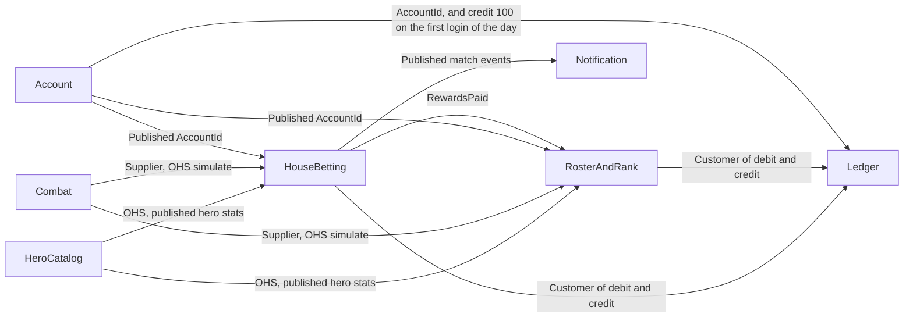

# Strategic Design — bet-herox

This document fixes the business model before aggregates, commands, or folders.

The words we speak, and the class and method names, are in [ubiquitous-language.md](./ubiquitous-language.md). That file wins on the word. [concepts.md](./concepts.md) wins on whether a named thing is a concept, data, or a rule.

Scope is the product that exists in code. The MySQL tables and columns use the words in the ubiquitous language.

## 1. The business

bet-herox is a game in which players watch two heroes fight and stake on the winner. The main loop:

1. The system picks two distinct catalog heroes and simulates the fight. The fight stops on a knockout or when the turn number reaches 20.
2. The result stays hidden for 2 minutes. Players place stakes while that window is open.
3. The fight is revealed, including the turn log and the winner, and stays on screen for 3 minutes.
4. At 5 minutes the winning stakes pay `amount × 2`. The next match starts when this one settles. Only one house match is in play at a time.

Supporting loops that already have code:

- Ranked challenge between two heroes owned by players, scored with Elo.
- A gem drop after a winning stake, then leveling that gem in storage. A gem does not change stats.

## 2. Domain and subdomains

A domain is one slice of the business, plus the concepts of that slice, plus the rules attached to those concepts. A rule is an invariant, a formula, or a legal state transition. A concept that receives no rule is data, not a domain.

Identify a domain in this order: choose one business slice, name its concepts, attach rules to those concepts.

Invest by how much the rules differentiate the product, not by how many tables the slice has.

### Core domain

**Combat** is the only core domain. Its concepts are `Fighter` (input data), `Trait`, and `CombatResult` (output data). Its rules are the 11 traits, the blow, turn order by speed, and the stop before turn 20. The formulas are in [concepts.md](./concepts.md). House betting and ranked challenge both call this domain. A trait change is a rule change for both callers. Combat does not import stakes, Elo, or accounts.

### Supporting domains

These slices have their own rules. They are not the core. House betting and roster sit closest to it, because they attach money or Elo to a `CombatResult`.

| Domain | Business slice | Concepts | Rules |
|---|---|---|---|
| House betting | Stake on the winner of a hidden fight | `HouseMatch`, `Stake` | One stake per account per match, on one of the two catalog heroes. The window is open for 2 minutes, the reveal lasts 3 minutes, settlement is at 5 minutes, and the next match starts then. Stake only while the window is open. Payout = `amount × 2` for the winning catalog hero. Phases move `Open → Revealed → Settled`. The stored simulation stays complete while the public view hides it |
| Roster and rank | Raise the one owned hero and rank it | `OwnedHero`, `Gem` | One owned hero per account, claimed from the catalog. Allocated points do not exceed level, and they set the five stats by the formulas in concepts.md. Level-up fee is `2^(currentLevel + 1)`, then level increases by 1. Elo starts at 1600. Challenge updates both Elo numbers with `kFactor` 20. A gem drops at 5% after a winning stake and can be leveled in storage. A gem does not change stats |

Gems are part of roster. A drop listens to `RewardsPaid`. It is not a rule of the match.

**Daily login grant** is a supporting rule with no context of its own. On a successful login, if that account has not been granted for the current calendar day in `Asia/Ho_Chi_Minh`, ensure a `Balance` exists (create it at 0 when it does not) and call ledger `credit(100)`. Later logins on the same day do not credit. The ledger does not know what a day or a login is.

### Reference data

`Hero` in the catalog is a name, base stats, and a trait name. No invariant, formula, or state transition attaches to that row. It is source data for Combat. House betting and roster read it and freeze a `Fighter` when a simulation starts. It is not a domain and it has no aggregate. Outside the catalog, do not call an owned hero or a fighter a `Hero`.

`Fighter` and `CombatResult` are also data. Combat reads the first and writes the second. The rules sit in `Trait` and the turn loop, not in the stored log.

### Generic domain

**Ledger** is a generic domain. The concept is `Balance`. The only rule is that a balance never goes negative. `debit` fails when the amount is greater than the balance. `credit` adds an amount. The `×2` payout and the level-up fee are rules of the domain that names the amount. The ledger only receives that amount.

The write is one conditional update (`balance = balance ± amount`, and `balance >= amount` on debit).

### Technical capabilities

These have no business rule. Wrap a library.

| Capability | Use | Holds no rule for |
|---|---|---|
| Account | Passport, JWT, bcrypt, email confirmation, address | Balance, heroes, stakes. Login does invoke one supporting rule, the daily grant, which is not an account rule |
| Notification | Socket.IO, email, Redis | When a match opens, is revealed, or is settled. It does not run the match clock |

## 3. Ubiquitous language

The language is [ubiquitous-language.md](./ubiquitous-language.md). One term, one meaning, one context. Method names are the verbs in that file. This document does not keep a second glossary.

`house_matches.phase` stores `Open`, `Revealed`, and `Settled`. Simulation finishes before the window opens. `reveal` publishes. It does not simulate again.

The public winner is hidden and the public turn log is empty while the match is `Open`. The internal `CombatResult` stays complete. Those two views do not share one getter.

## 4. Bounded contexts

Each context has one language. Aggregates named here are consistency boundaries, not class designs.

### Combat — core domain, upstream supplier

The language contains fighters, turns, traits, and results. Combat is the upstream supplier of that language. House betting and roster are customers. They call `simulate` and conform to `CombatResult`. They do not own or edit the fight rules, and they are not part of the core.

Inside: `Fighter`, `Trait` (11 hero names), `Turn`, `CombatResult`, a seedable random source.

Outside: accounts, money, stakes, Elo, the betting window.

Nothing is persisted. Nothing is published as a domain event. Two callers that pass the same seed get the same result. The caller does not mutate the input `Fighter`.

Used by the house match and by challenge.

### House betting — supporting, closest to the core

In this language, "match" means the house match.

Inside:

- `HouseMatch`: phase, two frozen `Fighter`s, the internal `CombatResult`, and whether the public view is still hidden.
- `Stake`: one `AccountId`, one match, one catalog `Hero`, `amount > 0`.

Rules:

- A match is created `Open`. `reveal` only from `Open`. `settle` only from `Revealed`. `Settled` accepts no further phase command.
- A stake is placed only while `Open`, on one of the two catalog heroes. One stake per account per match.
- Debit of `amount` and insert of the stake commit in one transaction. Debit is first inside that transaction. If the debit fails, the transaction rolls back and no stake remains.
- Settlement credits `amount × 2` for each stake whose catalog hero is the winner. It does not create money outside that formula.
- Reveal does not run the simulation again.
- One match lifecycle is 5 minutes, owned by this context. `open` at 0:00, `reveal` at 2:00, `settle` at 5:00. The next match starts when the previous one settles. The legacy clock (reveal at 60 seconds, settle at 180 seconds, cron every 3 minutes) is not the business rule. The scheduler that waits those delays is an adapter inside this context.

Outside: Elo, level, gems, email, JWT.

### Catalog — reference data, upstream

Inside: `Hero` rows (id, name, base stats, trait name). The name `Hero` is valid only in this context.

Outside: combat rules, stakes, ownership. There is no aggregate and no domain rule.

It publishes a catalog hero's stats. House betting and roster freeze those stats into a `Fighter` when a simulation starts. Pairing reads two distinct catalog heroes. It does not run combat.

### Roster and rank — supporting

In this language, "hero" means the one hero an account owns. Gems live here because a winning stake can drop one. A gem does not change the hero's stats.

Inside: `OwnedHero`, allocated points, level, the Elo number, `Challenge`, gem inventory.

Rules:

- One account has one `OwnedHero`, taken by `claim` from the catalog. A second claim is refused.
- The sum of allocated points does not exceed level. The five stat formulas are in [concepts.md](./concepts.md).
- Level-up debits `2^(currentLevel + 1)` first. If the debit fails, level stays unchanged. On success, level increases by 1.
- Challenge calls Combat `simulate` with the computed stats, then updates both Elo numbers with `kFactor` 20 from a starting 1600. It does not touch stakes or the house-match phase.

Outside: the betting window and the `×2` payout.

A gem drop is not a command the betting context dispatches. This context listens to `RewardsPaid` and decides whether to `drop`.

### Ledger — generic

Inside: the money of one `AccountId`, `debit`, `credit`.

The only rule: after every command, the balance is not negative. An insufficient debit is rejected with a ledger error.

The write is one conditional update (`balance = balance ± amount`, and `balance >= amount` on debit). Do not load the balance into memory and overwrite the user row. Name, email, and avatar are not fields of the ledger mapper.

### Account — technical

Inside: registration, login, password hashing, JWT, roles, email confirmation, address.

Outside: every balance change. Address is an attribute of the account, not a context.

A successful login is the moment the daily login grant runs. That grant is not an account rule and it is not a ledger rule. It calls `credit(100)` at most once per calendar day in `Asia/Ho_Chi_Minh`, creating a zero balance first when the account has none.

### Notification — technical, no aggregate

Socket, email, Redis. They subscribe to the published language and emit. They do not call `open`, `reveal`, or `settle`. The match clock is an adapter of house betting. Bull is the delay mechanism that adapter uses. It is not a context.

## 5. Context map

### Relationships

**Catalog to house betting, and catalog to roster.** The catalog is upstream reference data, published as an Open Host Service. The published language is the catalog hero's stats. The consumer freezes a `Fighter`. It does not import a catalog class. This is not an anti-corruption layer. The upstream shape is small and explicit.

**Combat is the upstream supplier** of house betting and of challenge. The relationship is Customer-Supplier. The published service is `simulate(Fighter, Fighter) → CombatResult`. Callers pass fighters in and conform to the result. A trait change is an upstream change. Both customers adapt. Neither customer edits the fight rules. Combat does not depend on Nest, TypeORM, or Bull.

**House betting and roster are customers of the ledger.** The ledger is the supplier and the upstream of the money truth. It offers `debit` and `credit`. Each customer translates `InsufficientFunds` into its own words: stake rejected or level-up rejected. That translation is a thin port. It is the same relationship for both customers. `placeStake` does not import an account exception.

**Account publishes `AccountId`.** Other contexts conform to that identifier. None of them receives a `User` aggregate. This is not an event stream. The daily login grant is the one call from login into the ledger: create a zero balance when missing, then `credit(100)` if today's grant has not been taken.

**House betting publishes events. Notification conforms.** `BettingOpened` carries no winner and no turn log. `FightRevealed` carries both, because the window is already closed. Notification does not own the clock.

**Roster conforms to `RewardsPaid`.** Gems listen. House betting does not import the roster module and does not dispatch `AddGemCommand`.

**House betting and challenge are Separate Ways.** Challenge rows live in `elo-matches`, not in `house_matches`. They do not share an aggregate. Elo does not pass through the betting window.

### Published language

Events that leave house betting:

| Event | When | Public payload |
|---|---|---|
| `BettingOpened` | The window has just opened | `matchId`, two public fighters, `openedAt`. No winner. No log |
| `FightRevealed` | The window has closed and the fight is public. Two minutes after open | `matchId`, `winnerId`, the turn log, phase |
| `RewardsPaid` | Credits and the settled mark have committed in one transaction | `matchId`, list of `{ accountId, stakeAmount, payout }` |
| `StakePlaced` | The stake row has committed | `matchId`, `accountId`, catalog hero id, `amount`. Audit only |

`RewardsPaid` is not published and then hoped to credit. Synchronous ledger calls are not events. Placing a stake and leveling up need the debit result immediately.

### Forbidden dependencies

- House betting imports classes from roster or account.
- A domain model imports `@nestjs/*`, `bcrypt`, `bull`, or `typeorm`.
- The house-betting application injects a Bull queue. The scheduler is an infrastructure adapter.
- The socket gateway sends a business command.

## 6. Consequences for the current tactical design

The following in `src/modules` break this map. Change the code. Do not change this map to match the drift.

| Current choice | Why it breaks the map | Direction |
|---|---|---|
| `Wallet` sits on the Identity `User` aggregate | Account and ledger are different languages. A stake and a level-up both write the user row | Ledger port `debit` / `credit` by `AccountId`. Account has no `deductBalance` |
| `HouseMatch` is the place for every kind of match | Challenge is not this language | House match only. `Challenge` stays in roster |
| `winner` and `turns` getters both hide the public view and feed `toOrm()` | The save wipes the simulation. Settlement then reads winner `0` | Two views: internal and public |
| `placeBet` checks stakes on an array the repository never loads | A second stake is not rejected | Unique `(accountId, matchId)`, and read it before the debit |
| Debit commits, then the stake insert commits. Settlement sets `END`, then credits one by one | A failed insert loses money. A retried job cannot pay | One transaction. Settlement is idempotent |
| A money write saves the whole account row | Every money write can clear a profile column | The ledger updates `accounts.balance` only |
| Betting dispatches an Identity command and plans to dispatch `AddGem` | The customer depends on the supplier's module, and betting would import roster | Ledger port. `RewardsPaid` for gems |
| `findByUserId(): OwnedHero \| null` | One account has one owned hero. Returning one matches the rule | Keep a single owned hero. `claim` refuses a second |
| `CombatEngine` is `@Injectable` and calls `Math.random` | Combat is not replayable and it depends on Nest | A `RandomSource` port. The formulas are the original loop in [concepts.md](./concepts.md), not the port that dropped max health |

Gems stay inside roster and wake up on an event. Do not fold them into Ranking to keep a four-module diagram.

## 7. Implementation order

Build the core domain first. Then the supporting domain that sits on its result.

1. Combat: plain TypeScript, seedable random source, property tests for the stop before turn 20 and for input immutability. Use the formulas in [concepts.md](./concepts.md).
2. House betting: phases, the hidden result stored separately from the public view, stakes, idempotent settlement, ledger port.
3. Ledger: `debit` / `credit` that stay correct under two concurrent requests. One rule.
4. Catalog: read-only `Hero` rows. Callers freeze a `Fighter`.
5. Roster: one owned hero per account, Elo with `kFactor` 20, listener for `RewardsPaid`.
6. Account and socket: wrap what already runs. No new domain.

## 8. Decisions now closed

These were open. Each one is now a rule in [concepts.md](./concepts.md). Do not reopen them by copying the incomplete `CombatEngine` port or a README sentence that has no use case.

1. **Equal health.** Away wins, including when the fight stops at turn 20. A speed tie also goes to away.
2. **Owned hero.** One per account, by `claim`. Points set the five stats by the formulas in concepts.md. Elo starts at 1600 and uses `kFactor` 20.
3. **Gems.** Six types. A 5% drop of a level-1 gem after a winning stake. `levelUpGem` spends storage for a chance at the next level. A gem does not change stats, and there is no attach action.

## 9. Corrections applied while translating

The previous Vietnamese draft had these inconsistencies. This English text is the one to follow.

| Draft claim | Check against code | Resolution |
|---|---|---|
| `closeBetting` and `reveal` are both phase commands | The state list has three transitions | One command, `reveal` |
| Elo shares the `house_matches` table | Elo is `@Entity('elo-matches')` | Challenge uses `elo-matches`. A house match uses `house_matches` |
| `RewardsPaid` may be published when credits are merely queued | A crash between publish and credit pays nobody or pays twice | Publish only after the settlement transaction commits |
| House betting is the core, and Combat is only a kernel inside it | The differentiating rules are the 11 traits and the turn loop. Stakes attach money to a finished `CombatResult` | Combat is the only core domain. House betting is supporting |
| Combat is a Shared Kernel co-owned with its callers | Fight rules are the product's distinctive rules. Betting and Elo must not change them | Combat is the upstream supplier. Customers call `simulate` and conform to `CombatResult` |
| The match clock is the code clock, and notification runs it | A house match has one 5-minute life: 2 minutes open, 3 minutes revealed, settle at the end. The next match starts then | House betting owns that timeline. Notification only emits. `FightRevealed` carries the winner and the turn log |
| Starting money has no rule | A new login has nothing to stake with, and `Balance` is never opened | The first login of a calendar day in `Asia/Ho_Chi_Minh` opens a zero balance when needed and credits 100 once |
| The hero catalog is a supporting domain | A catalog row has no invariant, formula, or state transition | `Hero` in the catalog is reference data. Roster remains a domain because `OwnedHero` has rules |
